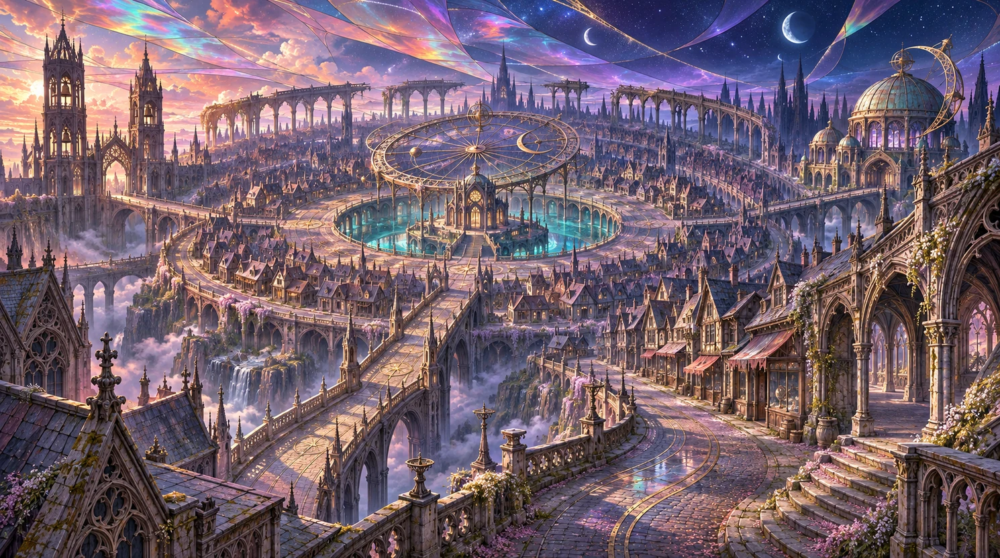
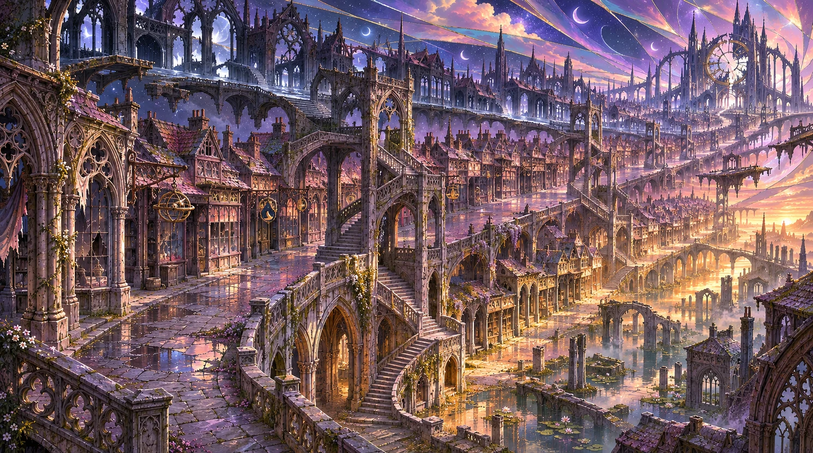
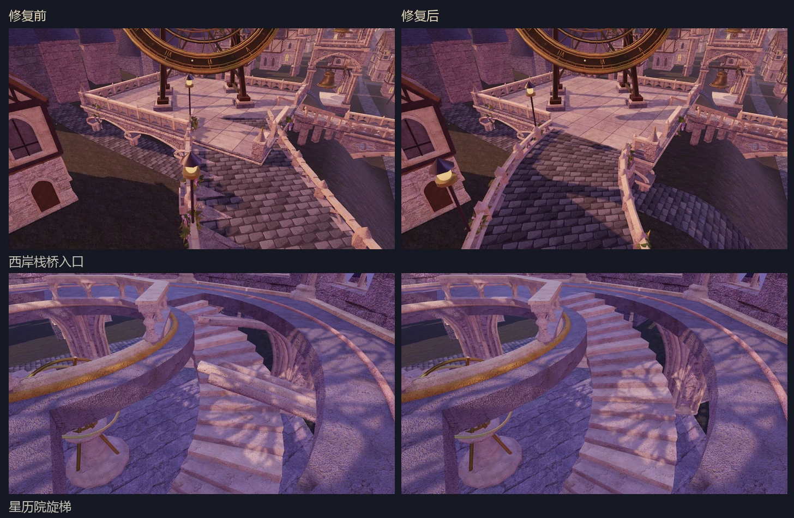

# 裂时之城 · 制作实例

两截石廊从一个指定机位看似接合。玩家横移后，断口和前后距离才一起显现。把概念图里的「时空断裂」变成一个需要玩家移动才能察觉的空间事件，决定了这座城的布局和镜头。

**[下载互动场景](https://github.com/P40-traveler/concept-to-threejs/raw/refs/heads/main/docs/index.html)** · **[观看实机换灯与视角演示](media/tour.webp)** · **[查看三个模型组的实际任务单](art/briefs.md)**

## 三个候选布局

共同的美术约束是镂空尖塔、多个月相和杏金色黄昏与靛蓝夜空的交界。主代理分别写提示词并生成三张布局图，再确定主路线。[三个实际提示词](art/layout-prompts.json)

| 断层阶城 · 入选 | 环形星盘城 | 三时叠街 |
| --- | --- | --- |
|  |  |  |
| 街面、桥下和高处能看见不同的断廊轮廓，低桥把两岸连通。 | 向心的三条路线利于绕看中央星盘，视线更多集中在同一地标。 | 垂直叠放最能强调时间层次，也最容易让玩家从街面看丢层与层的连接。 |

## 灰模与三份分区交接

先搭河谷、两岸平台、高低桥和塔的体积，并从真实相机位置出图。每个区域的生图同时参考选定总图与对应灰模。实际提示词要求主视图和侧面或背面描述同一个结构。[全城灰模](art/gray-overview.webp) · [分区与天空的实际提示词](art/region-prompts.json)

| 区域 | 灰模与建模图 | 明确交付什么 |
| --- | --- | --- |
| 西岸钟楼与断廊 | [灰模](art/gray-bridge.png) · [建模参考](art/west.webp) | 四墩镂空钟楼、倾斜的天文钟、两截错开的断廊。低桥底部保留可飞过的空间。 |
| 河谷旧市集 | [灰模](art/gray-market.png) · [建模参考](art/market.webp) | 沿弯街布置错落店铺、招牌、破棚和枯井，人在街面仍能辨认前进方向。 |
| 东岸星历院 | [灰模](art/gray-east.png) · [建模参考](art/east.webp) | 可绕行的八角观星院、开敞穹顶、玫瑰窗和台阶。飞到背面也能看懂支撑关系。 |

三个区域分别交给独立的 GPT-6.2 Astra Ultra 建模子 agent。主代理合并道路、地形、机位和灯光，给天空加上独立的月牙与碎片。图像模型还提供了[天幕纹理](art/sky.webp)。

## 单灯暴露了什么

西岸栈桥曾伸入钟盘平台约 4.6 米，栏杆挡住部分入口。星历院的部分拱肋则横穿上半段旋梯。修复时让桥沿接入平台的实际开口，踏面扇形拼合，把拱肋收至梯井外侧，再用同一机位复拍、用最终网格重新烘焙体素。

公开 HTML 提供四套照明。单灯只启用一盏方向光，主光可调为 0.25–2.00×。基础画面由 WebGL2 光栅化，G 切换世界空间体素射线，用于静态几何的遮蔽、一次漫反射与部分材质的粗糙反射。停稳后逐步累积采样；移动和换灯会让旧采样失效。离线包包含引擎、纹理、射线数据、图册和全部场景模块。

## 可以照着试的两种请求

- **从另一个布局出发。** 附上本页的「环形星盘城」，输入「用 $concept-to-threejs 保留向心动线，设计三种不同的中央地标。先把三个方案交给我选」。这个请求会停在选案阶段。
- **返修已有场景。** 把可编辑工程和出现问题的机位交给 Codex，输入「西岸桥头进不去。把桥面接到平台开口，保留断廊的刻意错位。用修前修后同机位对照，更新光追并再次测试离线 HTML」。这个请求从几何检查开始。
